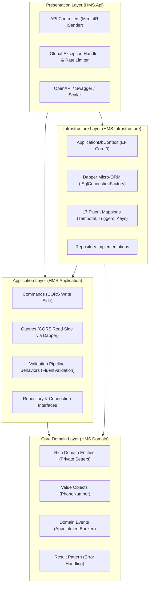

# Hospital Management System (HMS)

Enterprise-grade Hospital Management Backend built with ASP.NET Core (.NET 9), Clean Architecture, CQRS, MediatR, Entity Framework Core, Dapper, and SQL Server.

[](https://dotnet.microsoft.com/)
[](https://docs.microsoft.com/en-us/dotnet/csharp/)
[](https://blog.cleancoder.com/)
[](https://github.com/jbogard/MediatR)
[](https://github.com/DapperLib/Dapper)
[](https://www.microsoft.com/sql-server)
[](LICENSE)

---

## Architecture Overview

The solution adheres strictly to **Clean Architecture** principles, enforcing directional dependencies pointing inward toward the domain core.



---

## Solution Structure

```
HMS_Masterclass/
├── HMS.Domain/                # Pure domain core (zero external dependencies)
│   ├── Common/                # Entity<TId>, ValueObject, Result<T>, Error, IDomainEvent
│   ├── Entities/              # 19 Rich Entities grouped by business subdomain
│   └── ValueObjects/          # Self-validating Value Objects (e.g. PhoneNumber)
│
├── HMS.Application/           # Use cases, CQRS commands & queries
│   ├── Common/                # Interfaces, DTOs, ValidationBehavior pipeline
│   ├── Appointments/          # Book, Cancel, Reschedule, GetAppointments
│   ├── Patients/              # RegisterPatient, GetPatients (Dapper)
│   ├── Departments/           # CreateDepartment, GetDepartments
│   ├── Doctors/               # CreateDoctor, GetDoctors
│   ├── Medications/           # CreateMedication, GetMedications
│   ├── Prescriptions/         # IssuePrescription, GetPrescriptions
│   ├── LabOrders/             # CreateLabOrder, RecordLabResult, GetLabOrders
│   ├── Admissions/            # AdmitPatient, DischargePatient, GetRooms
│   ├── Invoices/              # CreateInvoice, PayInvoice, GetInvoices
│   ├── Insurances/            # CreateInsuranceProvider, GetInsuranceProviders
│   └── Staff/                 # CreateStaff, GetStaff, GetNurses
│
├── HMS.Infrastructure/        # Data persistence & external concerns
│   ├── Persistence/
│   │   ├── ApplicationDbContext.cs     # Unified EF Core context for all 19 tables
│   │   ├── SqlConnectionFactory.cs     # ADO.NET connection factory for Dapper queries
│   │   ├── Configurations/             # 17 Fluent mappings (temporal tables, triggers)
│   │   └── Repositories/               # EF Core repository implementations
│   └── DependencyInjection.cs          # Infrastructure service registration
│
└── HMS.Api/                   # Thin presentation host
    ├── Controllers/           # 11 Controllers delegating to MediatR ISender
    ├── BackgroundServices/    # HospitalMetricsBackgroundService (PeriodicTimer)
    ├── Middlewares/           # GlobalExceptionHandler (RFC 9457 Problem Details)
    ├── Program.cs             # Composition root
    └── HMS.Api.http           # Executable HTTP integration test suite
```

---

## Core Domain Entities (19 Tables)

| Business Subdomain | Database Schema | Tables / Entities |
|--------------------|-----------------|-------------------|
| Clinical Core | `clinical` | `Patients` (Temporal Table with History), `Appointments` |
| Clinical Services | `clinical` | `Prescriptions`, `PrescriptionDetails`, `Medications`, `LabOrders`, `LabTests` |
| Inpatient Care | `clinical` / `hr` | `Admissions`, `Rooms` |
| Human Resources | `hr` | `Departments`, `Staff`, `Doctors`, `DoctorSchedules`, `Nurses` |
| Financial & Billing | `billing` | `Invoices` (Partitioned), `InvoiceItems`, `InvoiceStatusLogs` (Audit Triggers), `InsuranceProviders`, `PatientInsurance` |

---

## Key Technical Features

### 1. Hybrid Persistence Strategy (CQRS)
- **Write Side (Commands):** Handled through Entity Framework Core 9 to preserve domain encapsulation, invariants, and change tracking across rich entities.
- **Read Side (Queries):** Executed through **Dapper** via `ISqlConnectionFactory` for ultra-low latency, direct raw SQL performance, and zero ORM tracking overhead.

### 2. Functional Result Pattern
- Eliminates unhandled domain exceptions. Business validation errors return typed `Result<T>` records with structured `Error` objects (`Validation`, `NotFound`, `Conflict`, `Failure`).

### 3. Automatic Validation Pipeline
- MediatR open pipeline behavior (`ValidationBehavior<TRequest, TResponse>`) automatically scans and validates requests with FluentValidation before reaching domain handlers.

### 4. API Versioning
- Configured with `Asp.Versioning.Mvc` supporting multiple resolution strategies:
  - URL Path Segment: `/api/v1/patients`
  - Query Parameter: `/api/patients?api-version=1.0`
  - Request Header: `X-Version: 1.0`

### 5. Enterprise Security & Performance
- **Authentication & Authorization:** JWT Bearer authentication with refresh token rotation and claim/role-based authorization policies.
- **Performance & Caching:** .NET 9 HybridCache, OutputCache, fixed-window rate limiting, and Brotli/Gzip response compression.
- **Observability:** Structured logging with Serilog (Console & rolling file sinks) and SQL Server Health Checks.
- **Documentation:** Interactive OpenAPI specification accessible via SwaggerUI and Scalar.

---

## Getting Started

### Prerequisites
- .NET 9.0 SDK
- Microsoft SQL Server 2022+ (Local or Express)
- Visual Studio 2022 (v17.12+) or VS Code with C# Dev Kit

### Setup & Run
1. Clone the repository:
   ```bash
   git clone https://github.com/Mostafa-Ismail1/HMS_Masterclass.git
   cd HMS_Masterclass
   ```

2. Update database connection string in `HMS.Api/appsettings.json`:
   ```json
   "ConnectionStrings": {
     "DefaultConnection": "Server=.;Database=HMS_DB;Trusted_Connection=True;TrustServerCertificate=True;"
   }
   ```

3. Build and run:
   ```bash
   dotnet build
   dotnet run --project HMS.Api
   ```

4. Explore documentation:
   - Swagger UI: `https://localhost:7219/swagger`
   - Scalar UI: `https://localhost:7219/scalar/v1`

---

## License

This project is licensed under the MIT License.
